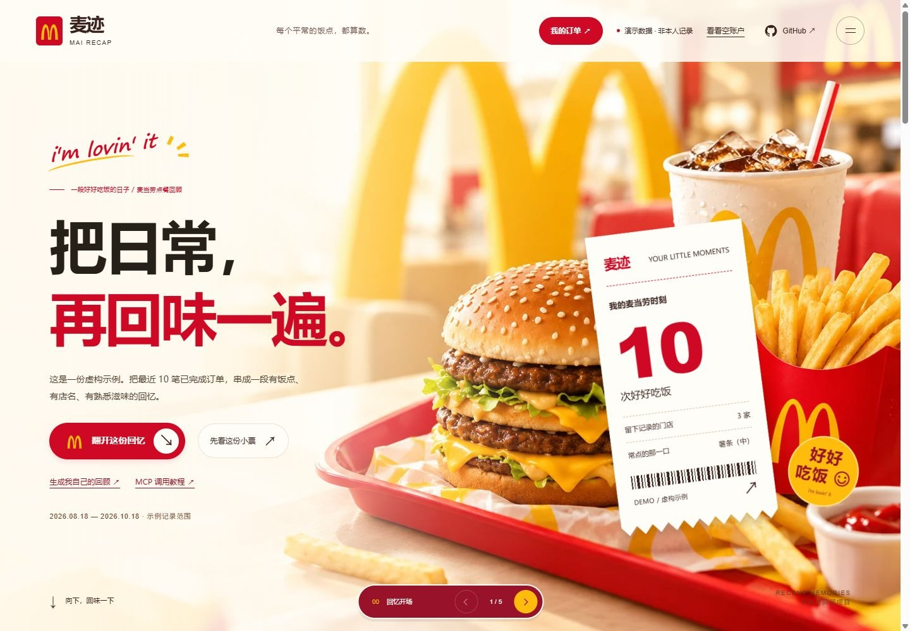

# 麦迹 mai-recap · 把日常，再回味一遍

将本人授权查询的近期麦当劳点餐记录做成一份逐页阅读的回顾，展示下单时段、出餐门店、常点餐品，并可保存一张不含门店名称和精确地点的分享卡。

基于麦当劳中国官方 MCP 的开源参赛项目，非麦当劳官方产品。采用年终总结式的逐页叙事体验，数据范围以本次实际可查询记录为准，不声称覆盖完整全年。目前尚未提交报名申请。



## 适合谁使用

- 想回顾近期下单时间、出餐门店和常点餐品的麦当劳会员。
- 想在本机生成回顾、保存不含门店名和精确地点的分享卡的用户。
- 想体验麦当劳 MCP 只读查询和本地报告生成的开发者。

只分析本人授权账号的记录，不推断实际用餐位置、身体状况或生活经历。

## 直接查看效果

在本仓库点击 **Code → Download ZIP**，解压后双击 `麦迹-演示.html`，即可在浏览器打开。不需要安装额外软件。

演示使用虚构的10笔订单，始终带有演示标记。点击“翻开这份回忆”，依次查看饭点、门店、餐品和分享卡；点击“保存分享卡”下载图片。右上角可切换查看空账户效果，示例不会自动填入真实空账户。

## 生成本人回顾

需要 Python 3.10 或更新版本，无第三方依赖。可下载 ZIP 解压，或通过 Git 获取源码：

```powershell
git clone https://github.com/dandan1232/mai-recap.git
cd mai-recap
```

在本目录打开终端并执行：

```powershell
python recap.py --live
```

按提示输入麦当劳官方 MCP Token。输入不会显示，凭证仅用于当次请求，不写入文件。生成的 `麦迹-我的回顾.html` 在本机打开，包含个人回顾，应自行保管。不要上传公开仓库。

申请凭证：https://open.mcd.cn/mcp

生成离线演示：

```powershell
python recap.py --demo
```

## 统计范围

- 官方历史点餐接口目前没有翻页或日期筛选参数；公开反馈是最近10笔。页面不会声称数据覆盖完整全年。
- 仅统计状态为已完成或已评价的订单。重复订单不重复计入。
- 时间统计使用北京时间。缺失或无法解析的时间不参与饭点分布。
- “在哪里”表示出餐门店，不推断用户实际用餐位置。缺少门店名的订单不猜测位置。
- 餐品按订单顶层名称统计，不再把套餐子项重复相加。“笔订单”和“份数”分别计算。
- 分享卡不含门店名称、精确地址、手机号、订单号和凭证。完整本地回顾仍包含门店与时间，不应随意公开。
- 无历史订单时保留空账户页面，只有主动选择示例才展示虚构数据。

## 实际验证与限制

2026-10-20 已连接官方服务：工具定义包含下单时间、门店、商品及数量。授权的空账户返回 `success=true, code=200, data={}`，已适配该响应。真实有订单账号的完整回顾仍待联调；当前订单内容与视觉演示使用虚构样例。

本版仅调用 `order-list`。不会创建订单、支付、领券、兑换或抽奖，不保存原始接口响应。

## 参赛材料

| 文件 | 内容 |
|---|---|
| `README.md` | 项目介绍、目标用户、安装和使用示例 |
| `CONTEST_DECLARATION.md` | 官方参赛声明原文，文件名和内容保持不变 |
| `MCP_INTEGRATION.md` | 实际使用的 Server、Tool、调用流程、业务价值及验证边界 |
| `mcp-config.example.json` | 仅使用环境变量占位符的连接配置示例 |
| `recap.py`、`mcp_client.py`、`template.html` | 可运行的项目源码 |

本地程序通过隐藏输入读取凭证；示例配置供支持环境变量替换的 MCP 客户端参考。它不是实际凭证文件，不应在仓库中改填真实值。

普通参赛不强制使用 WorkBuddy。WorkBuddy 专项奖励须真实使用 WorkBuddy 开发，并提交对应的 `workbuddy.md` 开发记录。当前未提供该记录，也不声称已符合专项奖励条件。材料齐备不等于报名成功，仍须通过活动仓库的指定 Issue 模板申请并取得成功回复。

完整要求以[官方活动规则](https://github.com/M-China/mcd-developer-innovation-challenge/blob/main/activityGuidelines.md)为准。

## 检查

```powershell
python -m unittest -v test_recap.py
```

涵盖空响应、业务失败、重复与取消订单、套餐统计、时间边界、隐私字段过滤和网页注入防护。

## 开源许可

原创程序代码使用 [MIT License](LICENSE)。麦当劳品牌、产品名称及官方声明模板的权利归各自权利人，MIT 许可不构成品牌或官方模板的授权。
