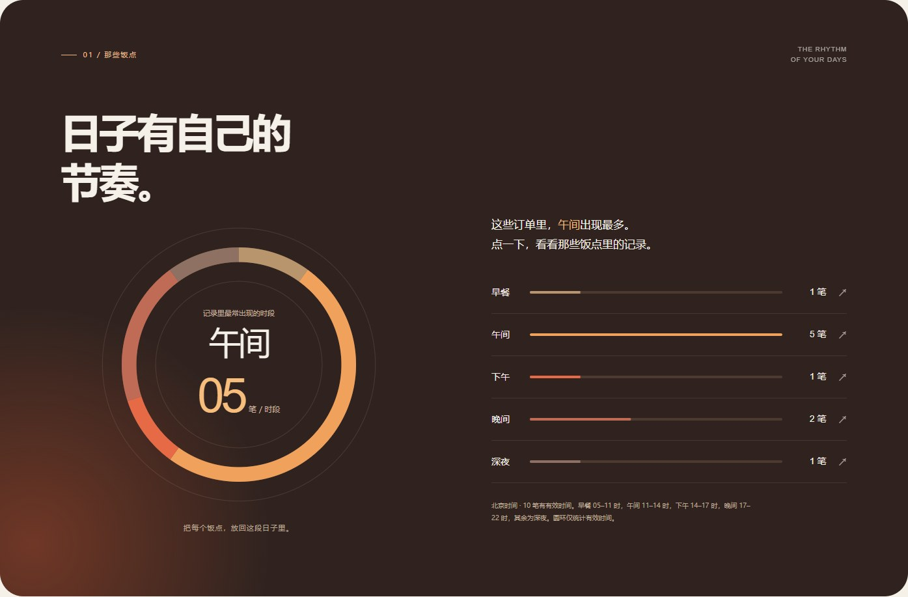
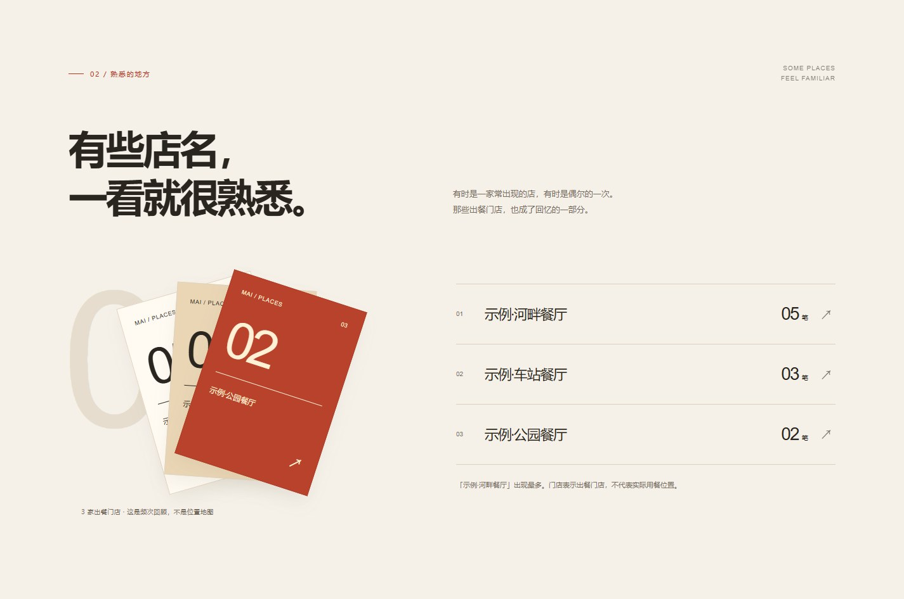
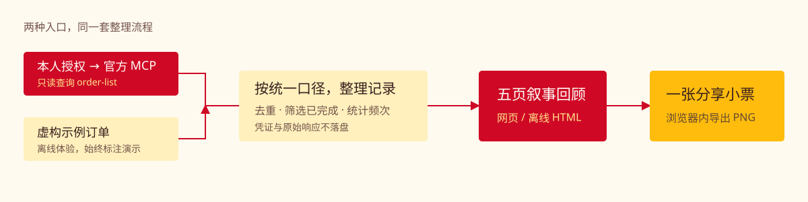

# 麦迹 · mai-recap

<p align="center">
  
</p>

<p align="center"><strong>把近期麦当劳点餐记录，变成一份值得收藏的回忆。</strong></p>

<p align="center">
  
  
  
  <a href="LICENSE"></a>
</p>

<p align="center">
  <a href="https://mai-recap.vercel.app/"><strong>在线体验</strong></a> ·
  <a href="https://github.com/dandan1232/mai-recap/archive/refs/heads/main.zip"><strong>下载演示 ZIP</strong></a> ·
  <a href="#快速体验">快速体验</a> ·
  <a href="#生成自己的回顾">生成自己的回顾</a> ·
  <a href="MCP_INTEGRATION.md">MCP 接入说明</a>
</p>

麦当劳程序员创意开发大赛开源参赛项目 · **非麦当劳官方产品** · 回顾范围以实际可查询记录为准。

## 有饭点，有店名，有熟悉的那一口

一笔订单里，有下单时间、门店和餐品。麦迹把这些信息串起来：从一张回顾小票出发，依次翻过饭点、门店、餐品，最后留下一张可以保存的分享卡。

**在这份虚构的10笔订单示例里：**

> 5笔下单发生在午间。<br>
> 「示例·河畔餐厅」出现在5笔订单中。<br>
> 中薯和麦辣鸡腿汉堡，各出现在4笔订单里。

这些平常的小选择，组成了这段时间的滋味。


<table>
  <tr>
    <td align="center" width="33%"><strong>饭点的节奏</strong><br>用下单时刻，看看这段时间的习惯。</td>
    <td align="center" width="33%"><strong>熟悉的门店</strong><br>看看哪些出餐门店反复出现。</td>
    <td align="center" width="33%"><strong>常点的那一口</strong><br>按订单频次，整理餐品回顾。</td>
  </tr>
  <tr>
    <td></td>
    <td></td>
    <td></td>
  </tr>
</table>

*以上截图均来自可运行的离线演示，使用虚构订单，非本人消费记录。*

## 一份回顾，可以留下什么

| 你想回顾的事 | 麦迹会怎样呈现 |
|---|---|
| 什么时候下单 | 北京时间的早餐、午间、下午、晚间、深夜分布，显示实际笔数 |
| 哪家店经常出现 | 按出餐门店统计频次，保留并列情况 |
| 最近反复点什么 | 分开统计“出现在几笔订单”和“合计几份”，套餐不重复拆算 |
| 想留一份纪念 | 生成本地 HTML 回顾；在最后一页保存 PNG 分享卡 |
| 账号还没有订单 | 留下空白页，主动切换后才显示带标记的示例 |

适合想回顾近期点餐记录的麦当劳会员，也适合想体验只读 MCP 接入和本地报告生成的开发者。

## 快速体验

**在线体验：**打开 [麦迹演示版](https://mai-recap.vercel.app/)，手机和电脑都可访问，无需登录或 Token，全部使用虚构订单。

**离线体验：**点击上方“下载演示 ZIP”，解压后双击 `麦迹-演示.html`。无需 Token、Python 或额外安装。

进入页面后，点击“翻开这份回忆”，最后一页可保存分享卡。右上角可以体验空账户页面。

**想从源码生成演示：**需要 Python 3.10 或更新版本，使用标准库即可运行。

```powershell
git clone https://github.com/dandan1232/mai-recap.git
cd mai-recap
python recap.py --demo
```

生成后打开 `麦迹-演示.html`。演示始终保留“虚构示例”标记。

## 部署演示版到 Vercel

仓库已包含 Vercel 配置，只发布虚构订单演示，无需 MCP Token 或其他环境变量。线上版支持五页回顾、空账户效果演示和 PNG 分享卡下载；真实订单查询仍使用下方的本地命令。

1. 登录 [Vercel](https://vercel.com/new)，导入 GitHub 仓库 `dandan1232/mai-recap`。
2. 根目录保持仓库根目录，框架选择 **Other**。仓库配置会指定构建命令 `node scripts/build-demo.mjs` 和输出目录 `dist`。
3. 点击 **Deploy**。连接 GitHub 后，后续推送到 `main` 会自动更新网站。

构建使用 Node.js 内置功能，无需安装第三方依赖或在 Vercel 运行 Python。本地可执行同一条命令，生成 `dist/index.html`。

网站只提供演示页面；构建会检查数据的演示标记，`.vercelignore` 只允许上传演示文件和构建配置，避免把本地个人报告或凭证带入部署。

## 生成自己的回顾

1. 在[麦当劳官方 MCP 平台](https://open.mcd.cn/mcp)登录，进入控制台申请连接凭证 Token。
2. 在项目目录执行下面的命令，按提示输入凭证。输入不会回显，也不会写入文件。
3. 打开生成的 `麦迹-我的回顾.html`，查看本次账号记录的回顾。

```powershell
python recap.py --live
```

完整回顾包含门店和日期，请在本机保管。导出的分享卡会省略门店名、精确地点、订单号和手机号。个人回顾已在 `.gitignore` 中排除。

## 从订单到回忆



| 环节 | 实际职责 |
|---|---|
| 麦当劳官方 MCP | 通过 `order-list {}` 查询本人授权账号的近期订单 |
| `mcp_client.py` | 建立连接、解析响应，区分空账户和查询失败 |
| `recap.py` | 订单去重、已完成状态筛选、北京时间和餐品频次统计 |
| `template.html` | 展示五页回顾，在浏览器内生成分享图片 |

真实模式只调用历史查询工具。凭证和原始响应不落盘；生成报告不需要部署网站或配置模型服务。

## 验证与边界

| 项目 | 当前验证情况 |
|---|---|
| 官方 MCP 真实连接 | 2026-10-20 已使用授权空账户成功查询，返回 `success=true, code=200, data={}` |
| 有历史订单的真实账号 | **待进一步联调**；当前内容演示使用虚构样例 |
| 数据处理 | **11项本地检查通过**，可用下面的命令复现 |
| 页面体验 | 已检查电脑、平板和手机尺寸的翻页、空状态和图片下载 |
| 全年历史记录 | **不承诺覆盖**；目前接口没有翻页或日期筛选参数，公开反馈为最近10单 |
| WorkBuddy 专项 | 当前未提供真实 `workbuddy.md` 开发记录，不声称已满足专项条件 |

```powershell
python -m unittest -v test_recap.py
```

<details>
<summary><strong>展开查看统计口径与隐私处理</strong></summary>

- 仅统计已完成或已评价订单，重复订单不会重复计入。
- 时间统一为北京时间；缺失或无法解析的时间不参与饭点分布。
- 门店表示出餐门店，不代表实际用餐位置；缺失门店名时不猜测位置。
- 餐品按订单顶层名称统计，套餐子项不会再次累加；笔数、份数分开计算。
- 空账户不会被自动填入示例；业务失败和未知响应格式也不会被当作空账户。
- 分享卡保留记录数量、饭点、常点餐品与日期范围，省略门店名称和精确地点。
- 不推断用户的身体状况、生活经历或全年消费水平。

接口接入与限制见 [MCP_INTEGRATION.md](MCP_INTEGRATION.md) 和[官方历史记录限制反馈](https://github.com/M-China/mcd-mcp-server/issues/13)。

</details>

## 项目结构

```text
mai-recap/
├── recap.py                   # 整理订单与生成本地回顾
├── mcp_client.py              # 官方 MCP 只读连接
├── template.html             # 叙事式回顾与分享卡
├── test_recap.py              # 11项数据与安全检查
├── 麦迹-演示.html             # 可直接打开的离线演示
├── scripts/build-demo.mjs    # 将虚构演示构建为网站首页
├── vercel.json              # Vercel 构建命令与网站输出目录
├── .vercelignore             # 部署文件白名单
├── docs/                     # 原创封面、流程图和演示截图
├── MCP_INTEGRATION.md         # 实际调用流程与验证情况
├── mcp-config.example.json    # 环境变量占位符配置示例
├── CONTEST_DECLARATION.md     # 官方参赛声明原文
└── LICENSE                   # 原创代码的 MIT 许可
```

<details>
<summary><strong>参赛材料与开源说明</strong></summary>

本仓库提供项目介绍、目标用户、安装与使用示例、官方声明原文、MCP 接入说明、脱敏配置和可运行源码。官方声明文件名与内容保持不变。

程序通过终端的隐藏输入读取凭证；`mcp-config.example.json` 供支持环境变量替换的 MCP 客户端参考，其中只保留占位符。

普通参赛不强制使用 WorkBuddy。若参加 WorkBuddy 专项奖励，须真实使用 WorkBuddy 开发并提交对应记录。当前尚未提交正式报名申请，报名与资格以[官方活动规则](https://github.com/M-China/mcd-developer-innovation-challenge/blob/main/activityGuidelines.md)及主办方审核为准。

原创代码使用 [MIT License](LICENSE)。麦当劳品牌、产品名称及官方声明模板的权利归各自权利人，MIT 许可不构成对品牌、官方模板或 MCP 服务的授权。

</details>
